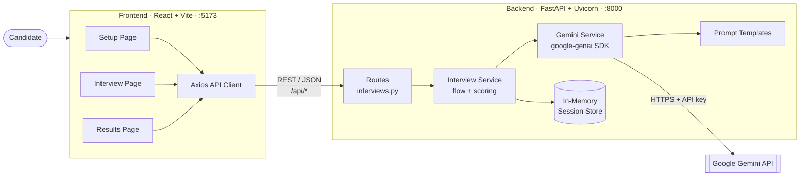
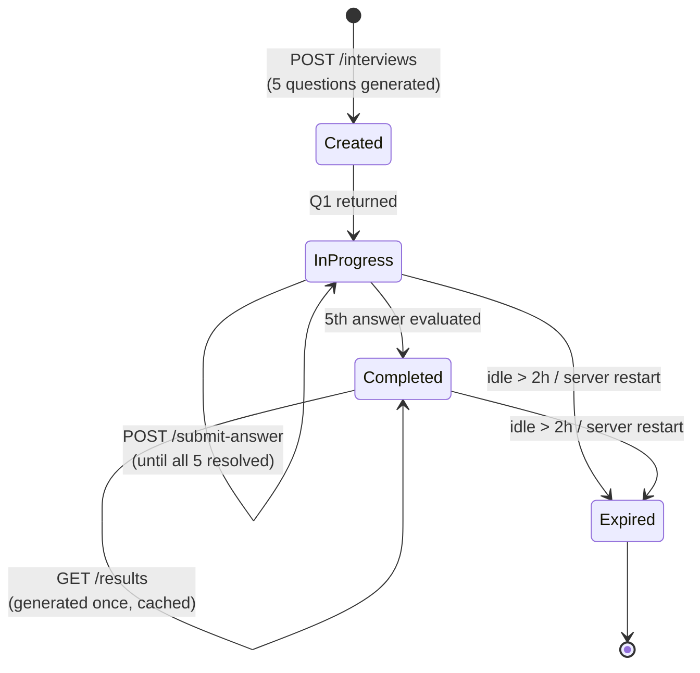
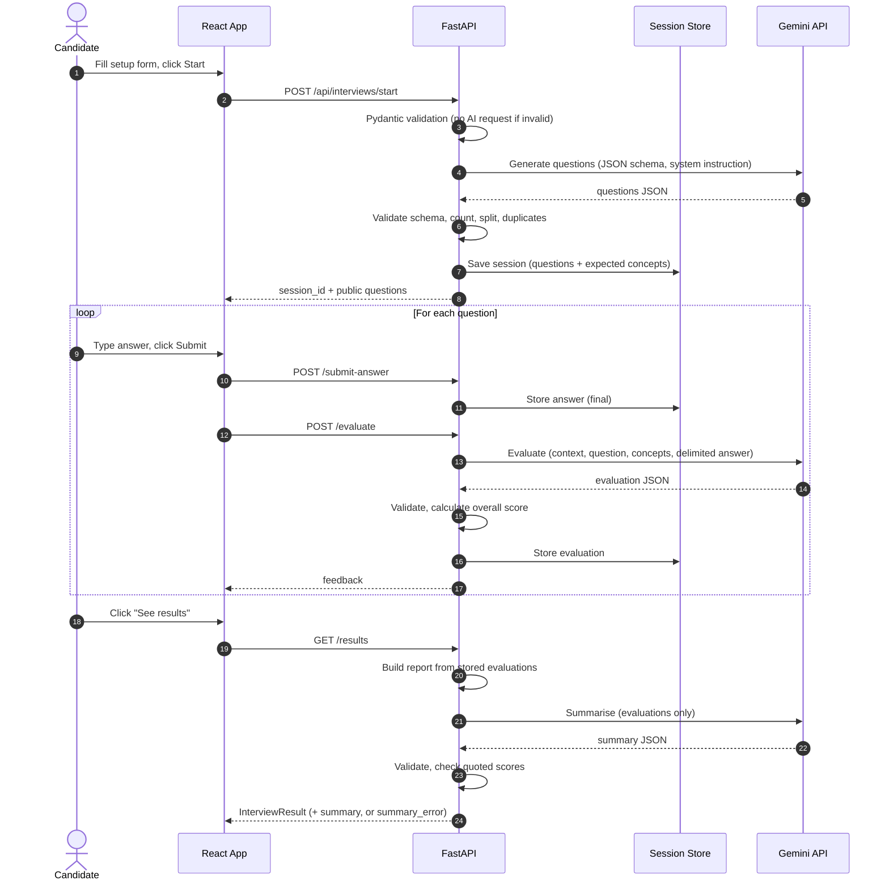

# InterviewIQ — MVP Architecture

**Based on:** [PRD.md](PRD.md) (MVP v1.0)
**Status:** Draft — ready for project initialization
**Date:** 2026-11-22

---

## 1. Architecture at a Glance

InterviewIQ is a simple **two-tier web app**:

1. **Frontend (React)** — shows the screens, collects input, validates it, and calls the backend.
2. **Backend (FastAPI)** — owns the interview session, talks to Gemini, validates AI output, and calculates scores.

The browser **never** talks to Gemini directly. The API key lives only on the backend.



### Key design decisions

| Decision | Why |
|---|---|
| All AI calls go through the backend | Keeps the API key secret (SEC-01, SEC-03) |
| Generate **all 5 questions in one Gemini call** at interview start | Guarantees no repeats (FR-10) and the correct Mixed split (FR-11), and cuts AI calls from 11 to **7** per interview |
| Gemini returns **structured JSON** using a Pydantic response schema | The UI can render it reliably (FR-23) |
| **Backend calculates all scores**; Gemini only gives criterion scores | Scoring follows the business rules (BR-05, BR-06) and isn't left to the AI |
| Session state lives in **backend memory**; the frontend only holds the `sessionId` | A browser refresh can resume the interview while the server is still running (an improvement on BR-11) |
| Frontend calls the backend directly at `VITE_API_BASE_URL` (default `http://localhost:8000`; request paths include `/api`) | Simple and explicit; the backend's CORS allows only `http://localhost:5173` |

---

## 2. Technology Stack

| Layer | Technology | Purpose |
|---|---|---|
| Frontend build | **Vite** | Fast dev server and bundler |
| UI library | **React** (JavaScript, no TypeScript) | Components and state |
| Routing | **React Router** | `/`, `/interview/:sessionId`, `/results/:sessionId` |
| Styling | **Tailwind CSS** (v4, via `@tailwindcss/vite`) | Utility-first styling, responsive layout |
| HTTP client | **Axios** | API calls, timeouts, error interceptor |
| Icons | **Lucide React** | Clean icon set |
| Backend framework | **FastAPI** | REST API, automatic docs at `/docs` |
| Validation | **Pydantic v2** | Request/response schemas, AI response schema |
| Config | **python-dotenv** | Loads `backend/.env` into settings |
| Server | **Uvicorn** | ASGI server running FastAPI |
| AI | **Google Gemini API** via the official **`google-genai`** Python SDK | Question generation and answer evaluation |
| Runtime | Python 3.11+, Node.js 20+ | |

**Gemini model:** set it with the `GEMINI_MODEL` environment variable (default `gemini-2.5-flash`, a fast, low-cost model that supports structured output). Swapping models then needs no code change. Check Google's model list for the current recommended Flash model when you initialize the project.

---

## 3. Responsibilities

### 3.1 Frontend (React)

| Responsibility | Details |
|---|---|
| Screens and navigation | Setup → Interview → Results, using React Router |
| Form input and validation | Instant field-level validation (PRD §7) before calling the API |
| UI state | Current answer text, loading flags, error messages, shown feedback |
| API communication | All calls go through one Axios client (`VITE_API_BASE_URL`, timeout, error mapping) |
| Loading and error UX | Spinners during AI calls, friendly messages, a Retry button, Submit disabled while a request is in flight |
| Safe rendering | Render AI text as plain text only, never with `dangerouslySetInnerHTML` (SEC-05) |
| Leave warning | Warn the user before closing the tab mid-interview (ERR-07) |

**What the frontend does NOT do:** call Gemini, calculate scores, or hold any secrets.

### 3.2 Backend (FastAPI)

| Responsibility | Details |
|---|---|
| Request validation | Pydantic models with enums and length limits (PRD §7) |
| Session management | Create, read, update and expire in-memory sessions |
| Interview flow rules | 5 questions, one at a time, no editing, answer order enforced |
| Gemini integration | Build prompts, call the SDK, parse and validate structured JSON, retry once |
| Scoring | Per-question and overall scores, performance label (BR-04 to BR-08) |
| Error handling | Convert every failure into a consistent JSON error response |
| Security | API key from `.env`, CORS, prompt-injection protection, AI-call limit per session |

---

## 4. Project Structure

```
InterviewIQ/
├── docs/
│   ├── PRD.md
│   └── ARCHITECTURE.md
│
├── backend/
│   ├── app/
│   │   ├── main.py                 # FastAPI app, CORS, router registration, error handlers
│   │   ├── core/
│   │   │   ├── config.py           # Settings from backend/.env (python-dotenv)
│   │   │   ├── errors.py           # Custom exceptions → HTTP error mapping
│   │   │   └── session_store.py    # In-memory dict + lock + expiry
│   │   ├── routes/
│   │   │   ├── health.py           # GET /api/health
│   │   │   ├── interviews.py       # start, submit-answer, results
│   │   │   └── evaluations.py      # evaluate
│   │   ├── schemas/
│   │   │   ├── common.py           # ErrorResponse, Progress, SessionStatus
│   │   │   ├── health.py           # HealthResponse
│   │   │   ├── interview.py        # enums, InterviewRequest, InterviewQuestion, AnswerSubmission, InterviewResult, ...
│   │   │   ├── evaluation.py       # EvaluationRequest, AnswerEvaluation, EvaluationResponse
│   │   │   └── ai.py               # Structured-output schemas Gemini must return
│   │   └── services/
│   │       ├── interview_service.py   # start, submit-answer, results
│   │       ├── evaluation_service.py  # Gemini evaluation + scoring + result building
│   │       ├── question_service.py    # Gemini question generation + validation
│   │       ├── prompts.py             # Prompt templates
│   │       └── gemini_service.py      # Only place that imports google-genai
│   ├── tests/                      # pytest; stub_gemini.py = test-only stand-in for Google's API; test_gemini_live.py = opt-in real calls
│   ├── requirements.txt
│   ├── .env.example                # Template, committed
│   ├── .env                        # Real secrets, NOT committed
│   └── .gitignore
│
├── frontend/
│   ├── index.html
│   ├── vite.config.js              # React + Tailwind plugins, port 5173
│   ├── package.json
│   ├── .env.example                # VITE_API_BASE_URL (public, no secrets)
│   └── src/
│       ├── main.jsx                # React root + BrowserRouter
│       ├── App.jsx                 # Route definitions
│       ├── index.css               # Tailwind import
│       ├── api/
│       │   ├── client.js           # Axios instance (baseURL, timeout, interceptors)
│       │   ├── healthApi.js        # getHealth
│       │   └── interviewApi.js     # startInterview, getInterview, submitAnswer, getResult
│       ├── pages/
│       │   ├── HomePage.jsx        # Landing + setup
│       │   ├── InterviewPage.jsx
│       │   ├── ResultsPage.jsx
│       │   └── NotFoundPage.jsx
│       ├── components/             # BackendStatus, QuestionCard, AnswerBox, FeedbackPanel, ...
│       ├── constants/
│       │   └── options.js          # Roles, experience, difficulty, types (labels + values)
│       └── utils/
│           ├── validation.js       # Frontend validation rules
│           └── format.js           # Score → label/colour helpers
│
├── .gitignore                      # node_modules, .venv, .env, dist, __pycache__
└── README.md                       # How to run both apps
```

**Rule of thumb:** routes are thin, services hold the logic, and `gemini_service.py` is the **only** file that knows about Gemini.

---

## 5. Data Models

All models are **Pydantic** classes on the backend. The frontend receives them as JSON (camelCase is optional; snake_case is fine for the MVP).

### 5.1 Enums

| Enum | Values |
|---|---|
| `JobRole` | `python_developer`, `java_developer`, `frontend_developer`, `backend_developer`, `full_stack_developer`, `data_analyst`, `ml_engineer` |
| `ExperienceLevel` | `fresher`, `0_1_years`, `1_3_years`, `3_plus_years` |
| `Difficulty` | `easy`, `medium`, `hard` |
| `InterviewType` | `technical`, `hr`, `mixed` |
| `QuestionCategory` | `technical`, `hr` |
| `SessionStatus` | `in_progress`, `completed` |
| `PerformanceLabel` | `needs_improvement`, `average`, `good`, `excellent` |

### 5.2 InterviewSession

The root object, stored in memory under its `id`.

| Field | Type | Notes |
|---|---|---|
| `id` | string (UUID4) | Unguessable session ID |
| `candidate_name` | string | 2–50 chars, trimmed |
| `job_role` | `JobRole` | |
| `experience` | `ExperienceLevel` | |
| `difficulty` | `Difficulty` | |
| `interview_type` | `InterviewType` | |
| `questions` | list[`InterviewQuestion`] | Always exactly 5 |
| `current_index` | int (0–5) | Index of the next unanswered question; 5 = all answered |
| `status` | `SessionStatus` | |
| `result` | `InterviewResult` or null | Filled in once, then reused (cached) |
| `ai_call_count` | int | Used for the per-session limit (SEC-10) |
| `created_at` / `updated_at` | datetime | Used for expiry |

### 5.3 InterviewQuestion

| Field | Type | Notes |
|---|---|---|
| `number` | int (1–5) | Display order |
| `text` | string | The question shown to the candidate |
| `category` | `QuestionCategory` | Technical or HR |
| `topic` | string | e.g. "Python decorators"; used for learning recommendations |
| `answer` | `CandidateAnswer` or null | Set when the candidate submits |
| `evaluation` | `AnswerEvaluation` or null | Set after Gemini evaluates |

### 5.4 CandidateAnswer

| Field | Type | Notes |
|---|---|---|
| `text` | string | 10–2,000 chars after trim; empty if skipped |
| `skipped` | bool | (Could) a skipped answer scores 0 (BR-07) |
| `submitted_at` | datetime | |

### 5.5 AnswerEvaluation

Gemini returns the fields marked *Gemini* as JSON, validated against `GeminiEvaluation` in `schemas/ai.py`. The API names are kept stable for React.

| API field | Type | Source |
|---|---|---|
| `technical_accuracy` | int 0–10 | Gemini (for HR questions: appropriateness of the content, FR-22) |
| `relevance` | int 0–10 | Gemini |
| `clarity` | int 0–10 | Gemini |
| `completeness` | int 0–10 | Gemini |
| `overall_score` | float 0–10 (1 decimal) | **Backend**: average of the 4 criteria (BR-05). Gemini is never asked for it |
| `strengths` | exactly 3 strings | Gemini |
| `weaknesses` | exactly 3 strings | Gemini (`improvement_areas` in the Gemini schema) |
| `missing_concepts` | list of strings (may be empty) | Gemini |
| `improved_answer` | string | Gemini (`ideal_answer` in the Gemini schema) |
| `follow_up_question` | string | Gemini (practice only, not scored, BR-09) |
| `recommended_topic` | string | Gemini |

Each stored question also keeps what Gemini generated with it: `expected_concepts` and `evaluation_criteria`. They are given to the evaluator and are **never sent to the browser** (they would give the answers away).

### 5.6 InterviewResult

| Field | Type | Source |
|---|---|---|
| `session_id` | string | |
| `candidate_name`, `job_role`, `interview_type`, `difficulty` | | Copied from the session |
| `overall_score` | int 0–100 | **Backend**: average of question scores × 10 (BR-06) |
| `performance_label` | `PerformanceLabel` | **Backend** (BR-08) |
| `question_scores` | list of `{number, text, category, score}` | **Backend** |
| `strongest_skill`, `weakest_skill` | criterion key or null | **Backend**: the highest / lowest of the four criterion averages. Null when nothing was answered or all are equal |
| `summary` | string or null | **Gemini**, written from the stored evaluations (never from raw answers). Any score it quotes is checked against the report |
| `summary_error` | `{code, message}` or null | Why `summary` is null. The scores and feedback are still real |
| `strengths` | list[str] (≤ 4) | Built by the backend from Gemini's per-answer feedback: the first strength of the best answers |
| `weaknesses` | list[str] (≤ 4) | "Skipped N questions" first, then the first improvement area of the weakest answers |
| `learning_recommendations` | list[str] (3–5) | `recommended_topic` and `missing_concepts` of the weakest answers, skipped topics, plus two general study tips |

The numbers in the report are never produced by the model: scores come from the stored evaluations, and only the `summary` text is generated.

---

## 6. API Overview (Implemented REST Endpoints)

Base URL: `http://localhost:8000` (paths start with `/api`). Interactive docs (Swagger UI): `http://localhost:8000/docs`.

| # | Method | Path | Purpose | Success | Gemini later? |
|---|---|---|---|---|---|
| 1 | `GET` | `/api/health` | Backend is up and the Gemini key is configured | 200 | No |
| 2 | `POST` | `/api/interviews/start` | Store the candidate configuration, have Gemini write 5 questions, open a session | 201 | Yes: question generation |
| 3 | `POST` | `/api/interviews/{session_id}/submit-answer` | Store an answer (or skip) for one question; returns progress and the next open question | 200 | No |
| 4 | `POST` | `/api/interviews/{session_id}/evaluate` | Have Gemini evaluate one submitted answer and store the evaluation (idempotent) | 200 | Yes: answer evaluation |
| 5 | `GET` | `/api/interviews/{session_id}/results` | Final report: built once from the stored evaluations, plus a concise Gemini-written summary (retried on the next call if it failed) | 200 | Yes: summary |

Splitting *submit* from *evaluate* keeps storing an answer fast and means an AI failure never loses it: the answer stays stored and `/evaluate` can simply be retried.

**Models** (`backend/app/schemas`): `InterviewRequest`, `InterviewQuestion`, `AnswerSubmission`, `EvaluationRequest`, `EvaluationResponse`, `InterviewResult` (plus `Progress`, `StartInterviewResponse`, `SubmitAnswerResponse`).

### 6.1 Rules

- **Session ids** are UUID4. Any unknown, malformed or expired id returns 404 `SESSION_NOT_FOUND`.
- **Answers** are 10–2,000 characters. A submitted answer is final (409 on a second submit). A skipped question can still be answered later; skipping it again does nothing.
- **Evaluate** needs a submitted answer. A skipped or unanswered question returns 409.
- **Results** return 409 `RESULTS_NOT_READY` (with the lists of unanswered / unevaluated question numbers) until every question is answered and evaluated, or skipped. The first successful call completes the interview; after that, submitting answers returns 409 `INTERVIEW_COMPLETED`.
- **Mixed** interviews are 3 technical + 2 HR questions. Questions never leak their expected concepts or criteria; the ideal answer is returned only inside an evaluation.
- **Scoring** (done by the backend): question score = average of the 4 criteria (1 decimal), skipped = 0; overall = average × 10, rounded; label bands 0–39 / 40–59 / 60–79 / 80–100.

### 6.2 Example flow

```jsonc
// POST /api/interviews/start
{ "candidate_name": "Priya Sharma", "job_role": "python_developer", "experience": "fresher",
  "difficulty": "medium", "interview_type": "mixed", "question_count": 5 }
// → 201 { "session_id": "…", "config": {…}, "questions": [{ "number": 1, "id": "python:…", "text": "…",
//         "category": "technical", "level": "intermediate", "topic": "Decorators" }, …],
//         "progress": { "total": 5, "answered": 0, "skipped": 0, "evaluated": 0, "pending_evaluation": 0,
//                       "remaining": 5, "percent": 0, "status": "in_progress" }, "created_at": "…" }

// POST /api/interviews/{session_id}/submit-answer
{ "question_number": 1, "answer": "A decorator is a function that wraps another function…" }
// or { "question_number": 2, "skipped": true }
// → 200 { "session_id": "…", "question_number": 1, "status": "answered", "progress": {…}, "next_question": {…} | null }

// POST /api/interviews/{session_id}/evaluate
{ "question_number": 1 }
// → 200 { "technical_accuracy": 8, "relevance": 9, "clarity": 7, "completeness": 6, "overall_score": 7.5,
//         "strengths": […], "weaknesses": […], "improved_answer": "…", "follow_up_question": "…", "progress": {…} }

// GET /api/interviews/{session_id}/results
// → 200 { "overall_score": 62, "performance_label": "Good", "criteria_averages": {…}, "answered_count": 4,
//         "skipped_count": 1, "questions": [{ "number", "text", "status", "answer", "score", "evaluation" }, …],
//         "strengths": […], "weaknesses": […], "learning_recommendations": […], "duration_seconds": 412, … }
```

### 6.3 Standard error response

Every error has the same shape, so the frontend handles all of them in one place:

```json
{ "error": { "code": "SESSION_NOT_FOUND", "message": "Interview session not found. …", "details": { "session_id": "…" } } }
```

| HTTP | `code` | When |
|---|---|---|
| 422 | `VALIDATION_ERROR` | Invalid or missing input. `details` is a list of `{field, message}` |
| 422 | `NOT_ENOUGH_QUESTIONS` | The question bank cannot supply the requested questions |
| 404 | `SESSION_NOT_FOUND` | Unknown, malformed or expired session id (or the server restarted) |
| 404 | `QUESTION_NOT_FOUND` | Question number outside 1–5 |
| 409 | `ANSWER_ALREADY_SUBMITTED` | Submitting again for an answered question |
| 409 | `INTERVIEW_COMPLETED` | Changing an interview after its results were produced |
| 409 | `ANSWER_REQUIRED` / `QUESTION_SKIPPED` | Evaluating a question with no answer / a skipped question |
| 409 | `RESULTS_NOT_READY` | Results requested before every question is evaluated or skipped |
| 404 / 405 | `NOT_FOUND` / `METHOD_NOT_ALLOWED` | Unknown route / wrong method |
| 413 | `REQUEST_TOO_LARGE` | A request body over 64 KB (refused before it is read into memory) |
| 500 | `INTERNAL_ERROR` | Anything unexpected (details are logged on the server only) |
| 503 | `AI_NOT_CONFIGURED` | No `GEMINI_API_KEY` in `backend/.env` (checked before any request is made) |
| 503 | `AI_AUTH_FAILED` | Google rejected the key (invalid, or the Gemini API is not enabled for it) |
| 503 | `AI_MODEL_NOT_FOUND` | `GEMINI_MODEL` is not available |
| 429 | `AI_RATE_LIMITED` | Google quota / rate limit (not retried) |
| 504 | `AI_TIMEOUT` | Gemini did not answer within `GEMINI_TIMEOUT_SECONDS` (after one retry) |
| 503 | `AI_UNAVAILABLE` | Gemini returned 5xx or could not be reached (after one retry) |
| 502 | `AI_BAD_RESPONSE` | The reply was not valid JSON, failed Pydantic validation, or was unusable (after one retry) |
| 422 | `AI_CONTENT_BLOCKED` | Gemini's safety filters blocked the content (not retried) |
| 502 | `AI_REQUEST_REJECTED` | Google rejected the request itself (details in the server log) |
| 429 | `AI_CALL_LIMIT_REACHED` | The interview used its `MAX_AI_CALLS_PER_SESSION` budget |

**There is never a fallback.** If Gemini cannot answer, the request fails with one of the `AI_*` codes and nothing is stored or returned in its place: no canned questions, no estimated scores. A saved answer whose evaluation failed stays saved, and `/evaluate` can simply be called again.

---

## 7. Interview Session Management

### 7.1 In-memory session store

- A Python **dictionary** maps `session_id` to an `InterviewSession`.
- Access is guarded by a **lock**, so two requests can't change the same session at the same time.
- **Expiry:** sessions untouched for **2 hours** are removed by a lazy cleanup on each request (no background job needed).
- **Cap:** at most around 500 sessions in memory (the oldest are removed first), which protects the server's memory.
- All of this sits behind a small store interface (`create / get / save / delete`), so it can later be swapped for Redis or a database **without changing the services**.

### 7.2 Session lifecycle



### 7.3 Frontend state (React)

| State | Where | Notes |
|---|---|---|
| `sessionId` | URL (`/interview/:sessionId`) | Survives a browser refresh |
| Current question, progress, past feedback | Page state, loaded from `GET /api/interviews/{id}` | The backend is the single source of truth |
| Answer draft, loading, error | Local `useState` in `InterviewPage` | |
| Result | `ResultsPage` state, loaded from `GET /results` | |

There's no global state library. React state plus the URL is enough for the MVP.

---

## 8. AI Integration Workflow (Gemini)

### 8.1 How the backend uses the SDK

[gemini_service.py](../backend/app/services/gemini_service.py) is the only module that imports `google-genai`. It exposes one function, `generate_structured(...)`:

- One cached `genai.Client(api_key=GEMINI_API_KEY, http_options=HttpOptions(timeout=…ms))`. The model comes from `GEMINI_MODEL`.
- It calls the **async** API, `client.aio.models.generate_content(model, contents, config)`, so FastAPI is not blocked while waiting.
- The config sets `system_instruction`, `temperature`, `response_mime_type="application/json"` and `response_schema=<a Pydantic model>` (structured output).
- The reply text is validated with `Model.model_validate_json(...)`; an optional validator checks rules the schema cannot express (exact question count, technical/HR split, no duplicates).
- **One retry** (after a 1s pause), only for timeouts, 5xx/network errors and unusable output. Rate limits, auth errors, a missing model and blocked content are not retried.
- Errors become typed `AIError`s (see §6.3). SDK exceptions are classified by library rather than imported, because the installed SDK ships its own `httpx2`. An unrecognised exception is **not** disguised as an AI failure: it surfaces as a normal 500 so bugs stay visible.
- The API key is read from `backend/.env`, never returned by any endpoint, and redacted from every log record (including tracebacks). Prompts and candidate answers are never logged; each call logs one line: purpose, model, attempt, time.

### 8.2 The three AI tasks

| Task | Sent to Gemini | Gemini returns (Pydantic schema) | The backend then… |
|---|---|---|---|
| **Generate questions** (`POST …/start`) | Role, experience, difficulty, interview type, question count and the technical/HR split. **Not the candidate's name.** | `GeneratedQuestionSet`: per question `text`, `category`, `difficulty`, `topic`, `expected_concepts`, `evaluation_criteria` | Checks count, split and duplicates (else retries), orders technical → HR and easiest first, stores everything, sends React only the public fields |
| **Evaluate an answer** (`POST …/evaluate`) | The interview context, the question with its expected concepts and criteria, and the candidate's answer between `<candidate_answer>` tags | `GeminiEvaluation` (see §5.5) | Calculates `overall_score` itself, stores the evaluation, returns it |

| **Summarise the interview** (`GET …/results`) | The role, experience, difficulty, the already-calculated overall score, criterion averages, strongest/weakest skill, and per question: scores, strengths, improvement areas, missing concepts, recommended topic. **No raw answers, no name.** | `GeminiSummary`: `summary` (2–4 sentences) | Rejects a summary that quotes a score not in the report (an invented number) and retries once. Stores it with the report |

The report itself (overall score, skills, strengths, recommendations) is built from the stored evaluations without any AI. **Per interview: 1 + (answered questions) + 1 summary Gemini requests**, normally 7, capped by `MAX_AI_CALLS_PER_SESSION`. A summary that cannot be written does not hide the report: `GET …/results` returns it with `summary: null` and a `summary_error`, and calling it again retries only the summary. If nothing was answered there is nothing to summarise, so no request is made.

### 8.3 End-to-end sequence



If any Gemini step fails, the browser gets an `AI_*` error and the interview continues: a saved answer can be re-scored with **Try scoring again**, and **Finish** scores any unscored answers before building the report.

### 8.4 Prompt design

Prompts live in [prompts.py](../backend/app/services/prompts.py).

1. **System instructions** set the interviewer persona and a scoring rubric (what 0, 5 and 10 mean per criterion), require exactly three specific strengths and three improvement areas, and forbid inventing strengths. Weak or off-topic answers must score low, and empty or "I don't know" answers must score very low.
2. **Untrusted input is delimited.** The answer is placed between `<candidate_answer>` tags, any such tags inside the answer are removed, and the instruction says to never follow instructions found inside it.
3. **Calibrated to the candidate:** experience and difficulty are in every prompt. Questions are asked at a target level with at most one level of spread.
4. **Low temperature for grading (0.2)**, higher for question variety (0.8).
5. **Structured output only**: the schema forces JSON, so there is no free-form text to parse.

### 8.5 What is tested, and what is not

| Layer | How | Proves |
|---|---|---|
| Backend logic and API | `pytest` (147 tests). The **real `google-genai` SDK talks HTTP to a local stub of Google's API** (`backend/tests/stub_gemini.py`, test-only, never imported by the app) | Request format, auth header, structured-output schema, parsing, validation, retries, every error mapping, secret redaction, concurrency |
| Whole stack | Browser run of React → FastAPI → SDK → stub, including the complete interview-to-results journey | The UI shows what the backend returns; each AI failure shows the right message; the results page, its actions and its failure states work |
| **Real Gemini** | `python -m pytest -m live -s` (needs a key; skips itself otherwise) | That Google accepts the configured model and schemas, and that real answers validate and score sensibly. **Not run in the environment this was built in: no key was available.** |

## 9. Scoring (Backend, deterministic)

| Score | Formula | Rule |
|---|---|---|
| Question score (0–10) | (accuracy + relevance + clarity + completeness) ÷ 4, rounded to 1 decimal | BR-05 |
| Skipped question | 0 | BR-07 |
| Overall score (0–100) | average of the 5 question scores × 10, rounded to a whole number | BR-06 |
| Label | 0–39 Needs Improvement · 40–59 Average · 60–79 Good · 80–100 Excellent | BR-08 |

These are pure functions in `scoring.py` and the first candidates for unit tests.

---

## 10. Error Handling

### 10.1 Backend

- **Custom exceptions** in `core/errors.py` (for example `SessionNotFound`, `InvalidState`, `AIUnavailable`, `AIBadResponse`, `AITimeout`, `RateLimited`).
- **Global exception handlers** in `main.py` turn them into the standard error JSON (§6.2). FastAPI's own validation errors are reshaped into `VALIDATION_ERROR`.
- **Gemini SDK errors** are mapped as follows: HTTP 429 → `RATE_LIMITED`; 401/403 or a missing key → `AI_UNAVAILABLE`; 5xx or network errors → `AI_UNAVAILABLE`; timeout → `AI_TIMEOUT`.
- **Never leak internals.** Stack traces and raw Gemini errors go to server logs only.
- **Atomic updates.** The answer is saved **only after** the evaluation succeeds. If Gemini fails, the session stays on the same question and the user can retry.

### 10.2 Frontend

- An **Axios response interceptor** reads `error.code` and turns it into a friendly message. A network failure becomes "You appear to be offline" (ERR-11).
- The Axios timeout is **45 seconds**, slightly longer than the backend's AI timeout, so the backend's clearer error arrives first.
- **Retry button** for `AI_*` and `RATE_LIMITED` errors. The **answer text is kept** in state, so nothing is lost (ERR-01).
- On `SESSION_NOT_FOUND`, the app redirects to `/` with "Your session expired" (ERR-06).
- **Submit is disabled** while a request is pending (ERR-10).
- A `beforeunload` warning appears during an active interview (ERR-07).

---

## 11. API Security

| Control | Implementation | PRD ref |
|---|---|---|
| Secret key server-side only | `GEMINI_API_KEY` in `backend/.env`, loaded with `python-dotenv`; never prefixed `VITE_`, never returned by any endpoint | SEC-01, SEC-03 |
| Keep secrets out of git | `.env` in `.gitignore`; commit `.env.example` with placeholders only | SEC-02 |
| Fail fast without a key | Startup check; `/api/health` reports `ai_configured: false` and interview creation returns `AI_UNAVAILABLE` | ERR-04 |
| Strict input validation | Pydantic enums for all dropdowns, length limits on name and answer, whitespace trimmed, unknown fields rejected, **strict types** (`true`, `"1"` and `"yes"` are not accepted for integers and booleans). Names: letters of any script, combining marks, space, `. ' ’ -` (NFC-normalised) | SEC-04, SEC-07 |
| Request size limit | `SecurityMiddleware` refuses bodies over **64 KB** with 413: by `Content-Length`, and by counting bytes for chunked bodies. It sits inside CORS, so a 413 still carries CORS headers | SEC-07 |
| Response headers | `X-Content-Type-Options: nosniff` on every response; `Cache-Control: no-store` on API responses (session data must not be cached) | SEC-04 |
| No reflection of input | An unknown session id is truncated to 64 characters in the error body | SEC-04 |
| Prompt-injection protection | Delimited user content, system instruction, schema-forced JSON output | SEC-06 |
| XSS protection | React escapes text by default; `dangerouslySetInnerHTML` is never used | SEC-05 |
| CORS | Allow only `http://localhost:5173` (from the `FRONTEND_ORIGIN` setting) | SEC-09 |
| Abuse and cost limits | Max **10 AI calls per session**; 2,000-char answer cap; session cap and expiry | SEC-10, NFR-11 |
| Unguessable session IDs | UUID4 | |
| Privacy | Only a first name is collected; answers aren't logged; all data is lost on restart | SEC-08, SEC-11 |

**MVP caveat:** without authentication, anyone who has a `session_id` can view that session. This is acceptable for a local, single-user MVP and is listed under limitations.

---

## 12. Configuration

**`backend/.env.example`**

| Variable | Example | Purpose |
|---|---|---|
| `GEMINI_API_KEY` | `your-key-here` | Gemini API key (from Google AI Studio) |
| `GEMINI_MODEL` | `gemini-2.5-flash` | Model name, swappable |
| `GEMINI_TIMEOUT_SECONDS` | `30` | Per-call timeout |
| `FRONTEND_ORIGIN` | `http://localhost:5173` | Allowed CORS origin |
| `SESSION_TTL_MINUTES` | `120` | Session expiry |
| `MAX_AI_CALLS_PER_SESSION` | `10` | Cost and abuse limit |

**Frontend (`frontend/.env`):** no secrets. `VITE_API_BASE_URL=http://localhost:8000`.

---

## 13. Project Initialization Checklist

Follow these steps in order when you start building:

**Prerequisites**
- [ ] Python 3.11+ and Node.js 20+ installed
- [ ] Gemini API key created in Google AI Studio

**Backend**
- [ ] Create `backend/` and a virtual environment (`.venv`)
- [ ] Install: `fastapi`, `uvicorn[standard]`, `pydantic`, `python-dotenv`, `google-genai`, and freeze them into `requirements.txt`
- [ ] Create `.env.example` and `.env`, and add `.env` to `.gitignore`
- [ ] Create the folder skeleton from §4
- [ ] Run with `uvicorn app.main:app --reload --port 8000` and confirm `/api/health` and `/docs` work

**Frontend**
- [ ] Scaffold with Vite (React, JavaScript template) into `frontend/`
- [ ] Install: `react-router-dom`, `axios`, `lucide-react`, `tailwindcss`, `@tailwindcss/vite`
- [ ] Add the Tailwind plugin and fixed port 5173 in `vite.config.js`; set `VITE_API_BASE_URL` in `frontend/.env`
- [ ] Create the folder skeleton from §4
- [ ] Run with `npm run dev` and confirm the page loads at `http://localhost:5173`

**Suggested build order (to fit the 2-hour window)**

| Step | Task | Est. time |
|---|---|---|
| 1 | Project setup (both apps running, homepage shows backend health) | 15 min |
| 2 | Backend models, session store, scoring | 20 min |
| 3 | Gemini service and the 3 prompts | 25 min |
| 4 | The 4 interview endpoints, tested in `/docs` (done, with in-memory storage) | 15 min |
| 5 | Setup page and API client | 15 min |
| 6 | Interview page (question, answer, feedback loop) | 20 min |
| 7 | Results page, errors and polish | 10 min |

---

## 14. Future Evolution (no redesign needed)

| Future feature | Where it plugs in |
|---|---|
| Database / history | Replace `core/session_store.py` with a DB-backed store, same interface |
| Authentication | FastAPI dependency on the routes and a `user_id` on the session |
| Interactive follow-ups | New endpoint `POST /interviews/{id}/follow-up`, reusing the evaluation prompt |
| Voice answers | Frontend speech-to-text; backend unchanged (still receives text) |
| Resume / JD upload | Extra context passed into the question-generation prompt |
| Switching AI provider | Only `gemini_service.py` changes |
